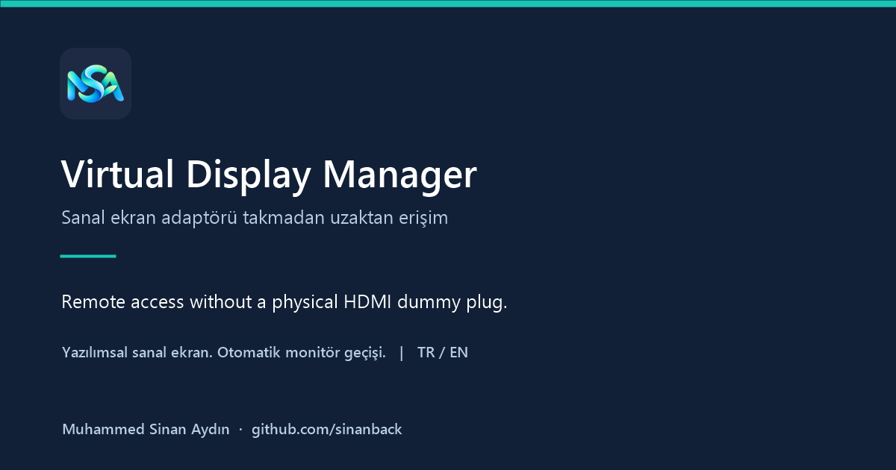

# Virtual Display Manager
### Monitörsüz bilgisayarlarda uzak bağlantı için sanal ekran

**Sanal ekran adaptörü takmadan, monitörsüz bilgisayarınıza uzaktan erişin.**  
**Remote access to a headless Windows PC without a physical HDMI dummy plug — using a software virtual monitor.**

`Windows 10/11 x64` · `PowerShell 5.1` · `Türkçe / English` · `2.0.2 public preview`

[Web sitesi / Website](https://sinanback.github.io/virtual-display-manager/) · [Türkçe](#turkce) · [English](#english) · [İndir / Download](https://github.com/sinanback/virtual-display-manager/releases) · [Kaynak / Source](src/)

**[Hazır tek dosyalı CMD indir / Download ready-to-run CMD](https://github.com/sinanback/virtual-display-manager/releases/download/v2.0.2-preview.1/Virtual-Display-Manager-Portable.cmd)**

<a id="turkce"></a>
## Türkçe

### Sanal ekran adaptörü yerine yazılımsal çözüm
Fiziksel **HDMI dummy plug / sahte ekran adaptörü**, bilgisayara bir monitör bağlıymış gibi davranan küçük bir donanımdır. Bu programın kullandığı VDD, benzer ekran ihtiyacını yazılımsal bir sanal monitörle karşılar; uygun Windows ve uzak erişim düzenlerinde **fiziksel sanal ekran adaptörü ihtiyacını ortadan kaldırır**. Ekran aygıtı yine vardır; bunu donanım adaptörü yerine sürücü sağlar.

### Bu program ne işe yarar?
**Asıl amaç, harici ekran bağlı olmayan Windows cihazlarda uzak bağlantı aracının görüntü alamaması sorununa sanal ekran üzerinden yardımcı olmaktır.** Bazı sistemlerde monitör sökülünce yakalanabilecek aktif bir ekran kalmaz; bağlantı kurulsa bile siyah ekran, boş görüntü veya “görüntü bekleniyor” mesajı görülebilir.

Virtual Display Manager içindeki kurulum akışı **Virtual Display Driver (VDD)** ile Windows'a bir sanal monitör ekler. Uygulama bu aygıtı yönetir: fiziksel ekran yokken sanal ekranı açık tutar, aktif fiziksel monitör bağlanınca kapatır ve son monitör sökülünce yeniden açar. Böylece her seferinde Aygıt Yöneticisi'nden elle işlem yapmanız gerekmez.

**Örnek:** Evdeki mini PC'niz açık ama monitör bağlı değil. Uygun uzak bağlantı yazılımınızın masaüstü görüntüsünü alabilmesi için sanal ekranı kullanırsınız. Daha sonra gerçek monitörü bağladığınızda uygulama sanal ekranı otomatik devre dışı bırakır; monitörü sökünce tekrar etkinleştirir.
| Durum | Otomatik modda uygulamanın yaptığı |
|---|---|
| Aktif fiziksel monitör yok | Kurulu ve devre dışı VDD'yi etkinleştirir. |
| En az bir aktif fiziksel monitör var | Etkin VDD'yi devre dışı bırakır. |
| Monitör bağlantısı doğrulanamıyor | Mevcut durumu korur ve uyarı gösterir. |

### Kullanım alanları
- **Uzaktan erişimde siyah ekran / görüntü bekleniyor:** sorun fiziksel ekranın bulunmamasından kaynaklanıyorsa sanal monitörle görüntü üretimi için bir ekran sağlamak.
- **Monitörsüz mini PC, ev sunucusu veya çalışma bilgisayarı:** Windows masaüstünü uygun bir uzak erişim aracıyla kullanırken sanal ekranı yönetmek. Uygulamayı her Windows oturumunda bir kez başlatın.
- **Uzaktan teknik destek:** fiziksel monitör bağlayacak biri bulunmadığında, önceden kurulmuş ve çalışan sanal ekran düzenini yönetmek.
- **Masaüstü/oyun görüntüsü aktarımı:** sanal monitör yakalamayı destekleyen yazılımlar için bir ekran kaynağı sağlamak; GPU ve ekran seçimi yayın yazılımında ayrıca yapılandırılabilir.
- **HDMI dummy plug yerine yazılımsal seçenek:** uygun sürücü ve yakalama düzenlerinde fiziksel sahte ekran adaptörü ihtiyacını azaltabilecek sanal monitör kurulumu.

### Otomatik geçişin ek faydası
- **Monitörsüz PC (headless PC)** kullananlar: uygun uzak erişim veya görüntü aktarımı düzenlerinde sanal ekranı yönetmek için.
- **Bazen monitör takılan bilgisayarlar:** fiziksel ekran ile sanal ekran arasında elle aygıt aç/kapat işlemini azaltmak için.
- **VDD'yi elle yönetmek isteyenler:** aç/kapat düğmeleri, saat yanındaki simge ve işlem kayıtlarıyla tek yerden kontrol için.

Bu uygulama tek başına uzak bağlantı kurmaz; uzaktan erişim programınız ayrıca gerekir. Her siyah ekran sorununun çözümü değildir. Belirli uzak masaüstü veya oyun aktarım uygulamalarıyla uyumluluk bu yayında test edilmemiştir.

**Geliştirici:** [Muhammed Sinan Aydın](https://www.linkedin.com/in/sinanback/) · [GitHub](https://github.com/sinanback)

Bu depo uygulamanın yeniden üretilebilir PowerShell kaynaklarını içerir. Virtual Display Driver'ın kendisi farklı bir projedir: [resmî sürücü kaynağı](https://github.com/VirtualDrivers/Virtual-Display-Driver). Hazır tek dosyalı CMD, çevrimdışı sürücü kurulum bileşenlerini içerir; uygulamanın kaynakları ayrıca sunulur.

### Öne çıkan özellikler
- Aktif fiziksel ekran varken VDD'yi kapatma; son fiziksel ekran sökülünce yeniden açma.
- İki ardışık örnek ve işlem öncesi doğrulama; algılama belirsizse mevcut durumu koruma.
- Kalıcı Türkçe/İngilizce dil seçimi, iki dilde kullanıcı kılavuzu ve uyarılar.
- Açılışta görünen ana pencere; çarpı/küçültme ile saat yanına gizlenme, simgeden geri açma ve tam çıkış.
- Uygulama simgesi; yeşil/gri/turuncu durum noktası ve açıklayıcı simge metni.
- Yerel cihaz işlemleri günlüğü, hata ayrıntıları ve son 500 kaydı JSONL dışa aktarma.
- Arayüzü bekletmeyen arka plan aygıt sorguları; kalıcı Terminal penceresi oluşturmayan CMD başlatıcısı.

### İndirme ve kullanım
1. **[Virtual-Display-Manager-Portable.cmd](https://github.com/sinanback/virtual-display-manager/releases/download/v2.0.2-preview.1/Virtual-Display-Manager-Portable.cmd)** dosyasını indirin. Windows 10/11 x64, Windows PowerShell 5.1 ve .NET Framework gerekir.
2. CMD dosyasını kalıcı bir klasöre koyun. Yanına PS1 veya başka bir dosya eklemeniz gerekmez.
3. **Virtual-Display-Manager-Portable.cmd** dosyasını çift tıklayarak açın.
4. Windows yönetici iznini onaylayın. VDD kurulu değilse uygulamadaki **Sürücüyü kur** düğmesini kullanın. Kurulum bileşenleri CMD içinde hazırdır.
5. Otomatik kontrol varsayılan olarak açıktır. Elle aç/kapat için otomatik kontrol seçeneğini kapatın. Dahili dizüstü ekranı da fiziksel ekran sayılır.
6. Çarpı, uygulamanın arka planda kaldığını açıklayıp pencereyi gizler. Geri açmak için saat yanındaki simgeye çift tıklayın. Tam çıkış: simgeye sağ tık → **Tamamen çık**.

Uygulama Windows açılışına otomatik eklenmez; her oturumda bir kez çalıştırın. Çıkış yapmak VDD'nin o anki durumunu değiştirmez. Windows simgeyi gizli simgeler menüsüne taşıyabilir.

### Bu ihtiyaç neden oluşuyor?
[AnyDesk'in “Waiting for image” açıklaması](https://support.anydesk.com/docs/waiting-for-image), fiziksel monitör yokken ekran sürücüsünün devre dışı kalmasının görüntü alınamamasına yol açabildiğini anlatır. [RealVNC'nin Windows görüntü sorunları kılavuzu](https://help.realvnc.com/hc/en-us/articles/360004012211-Display-issues-when-connecting-to-RealVNC-Connect-for-Windows) da monitörsüz cihazlarda benzer sorunları ve kendi sanal ekran çözümünü açıklar. Bunlar kullanım ihtiyacını doğrular; bu projenin o ürünlerle test edilmiş entegrasyonu olduğu anlamına gelmez.

Her uzak bağlantı aracı aynı davranmaz: [güncel TeamViewer sürümleri Windows'ta yerleşik sanal monitör desteği sunar](https://www.teamviewer.com/en/global/support/knowledge-base/teamviewer-remote/troubleshooting/black-screen-after-starting-a-connection/), bu nedenle her kurulumda ek VDD gerekmeyebilir. [Sunshine'ın Windows yakalama açıklaması](https://docs.lizardbyte.dev/projects/sunshine/latest/md_docs_2getting__started.html) ise kullanılan GPU ile ekran ilişkisinin önemini belirtir; yalnızca sanal monitör eklemek her yayın yapılandırmasını tamamlamaz.
### Sık sorulan sorular
**Sanal ekran ile fiziksel monitör arasındaki fark nedir?** Fiziksel monitör gerçek ekranınızdır. VDD'nin oluşturduğu sanal monitör, Windows'un ekran olarak kullanabildiği bir yazılım aygıtıdır.

**Sürücü ile bu program aynı şey mi?** Hayır. VDD ekran aygıtını sağlar; Virtual Display Manager onun açılma/kapanmasını yönetir. Hazır CMD içinde sürücüyü kurmayı başlatabileceğiniz bileşenler bulunur.

**Dizüstü bilgisayarın kendi ekranı sayılır mı?** Evet. Windows'un aktif fiziksel ekran olarak bildirdiği dahili panel de sayılır; böyle bir panel varken otomatik mod VDD'yi kapatır.

**Windows açılınca otomatik başlar mı?** Bu sürüm başlangıca görev eklemez. Her oturumda CMD'yi bir kez başlatın; pencereyi kapatsanız da saat yanındaki simgede izleme sürer.

**Kaynak kodu bilmem veya derlemem gerekir mi?** Hayır. Üstteki hazır CMD'yi indirip çalıştırmanız yeterlidir.
### Cihaz değişiklikleri ve gizlilik
Uygulama yönetici izniyle VDD aygıtını etkinleştirebilir/devre dışı bırakabilir veya kullanıcı onayıyla kaldırabilir. Çevrimdışı paket ayrıca sağlandığında onaylı kurulum akışı sürücü ve Visual C++ bileşenlerini kurabilir. Ana uygulama EXE değildir; PowerShell süreci arka planda çalışır. Kurulum bileşenleri ayrı üçüncü taraf yürütülebilir dosyalardır.

Dil ayarı ve günlükler `%LOCALAPPDATA%\VDD-Yonetici` altında tutulur; bu klasör önceki sürümlerle uyumluluk için korunmuştur. Günlükler yaklaşık 2 MiB'de döner; bir eski dosya saklanır. Dışa aktarım son 500 kaydı içerir; UTC zamanları, aygıt kimlikleri ve teknik ayrıntılar bulunabilir. Uygulama telemetri göndermez. Dışa aktarmadan önce kayıtları inceleyin.

### Sınırlar ve doğrulama
Fiziksel ekran yokken VDD'yi elle kapatmak uzak bağlantıyı kesebilir. Otomatik geçiş yalnızca Windows'un aktif fiziksel ekran olarak raporladığı aygıtları sayar; HDMI sahte ekran adaptörleri gerçek monitörden ayırt edilemeyebilir. Uyumsuz sürücüler/Windows durumları için başarı garantisi verilmez.

Bu yayın **ön sürümdür**. Dil, arayüz yaşam döngüsü, konsolsuz başlatıcı, simge pikselleri ve simüle bağlantı senaryoları test edilmiştir. İki fiziksel ekranın salt okunur sorgusu doğrulanmıştır. Gerçek kablo tak/çıkar, sürücü kurulum/kaldırma, yeniden başlatma ve tüm DPI ölçekleri bu hazırlıkta doğrulanmamıştır. Ayrıntılar: [test sonuçları](docs/TEST_RESULTS.md), [yayın kontrol listesi](docs/RELEASE_CHECKLIST.md).

### Kaynak ve derleme
```text
src/            Arayüz, TR/EN metinler ve arka plan aygıt işlemleri
assets/         Uygulama simgesi, uyumlu ICO ve özgün PNG simge boyutları
scripts/        Paket ve simge üretim betikleri
tests/          Salt okunur donanım, politika, arayüz ve paket testleri
docs/           Test sonuçları ve yayın öncesi donanım kontrolleri
```

```powershell
powershell.exe -NoProfile -ExecutionPolicy Bypass -File .\scripts\build.ps1
powershell.exe -NoProfile -STA -ExecutionPolicy Bypass -File .\tests\verify.ps1
powershell.exe -NoProfile -ExecutionPolicy Bypass -File .\tests\verify-icon.ps1
```

Çıktılar `dist/` altındadır. İsteğe bağlı çevrimdışı paket ile tek dosyalı CMD üretmek için `-DriverBundle C:\packages\VDD-offline-bundle.zip` kullanın. Paket `Signed-Driver-*.zip` (`MttVDD.inf`), `devcon.exe` ve isteğe bağlı `vc_redist.x64.exe` içermelidir. Çevrimdışı sürücü açılışta değil yalnızca kurulum onayından sonra çıkarılır. Dağıtımdan önce [üçüncü taraf bileşenleri](THIRD_PARTY_NOTICES.md) inceleyin. Paket özetleri `SHA256SUMS.txt` dosyasındadır.

### Lisans durumu
Diğer projelerimdeki yayın düzeniyle uyumlu olarak bu depoya ayrıca açık kaynak lisansı verilmemiştir; public erişim sınırsız yeniden dağıtım izni anlamına gelmez. Marka görselleri ve üçüncü taraf bileşenlerin hakları sahiplerine aittir. Bu bağımsız proje Microsoft veya Virtual Display Driver geliştiricileri tarafından geliştirilmiş ya da onaylanmış değildir.

---

<a id="english"></a>
## English

### A software alternative to a physical HDMI dummy plug
An HDMI dummy plug is a hardware display emulator that makes a computer detect a connected monitor. VDD provides a software virtual monitor instead. In suitable Windows and remote-access configurations, this **removes the need for a physical dummy display adapter**. The display device is supplied by a driver rather than a hardware dongle.

### What does this program do?
**The main purpose is to help remote-access tools obtain a picture from Windows devices with no external monitor attached.** On some systems, disconnecting the monitor leaves no active display to capture. The remote session may connect but show a black screen, a blank picture or a “waiting for image” message.

Virtual Display Manager's installation flow uses **Virtual Display Driver (VDD)** to add a virtual monitor to Windows. The utility then manages that device: enable it when no physical display is active, disable it when a physical monitor is connected, and re-enable it when the last physical monitor is disconnected.

**Example:** A mini PC at home runs without a monitor. Its virtual screen provides a display that suitable remote-access software can capture. Plug in a real monitor and the utility disables VDD; unplug it and the virtual screen is enabled again.
| Display situation | Automatic behavior |
|---|---|
| No active physical monitor | Enable the installed, disabled VDD device. |
| One or more active physical monitors | Disable the enabled VDD device. |
| Monitor detection is uncertain | Preserve the current state and display a warning. |

### Use cases
- **Remote access with a black screen or “waiting for image”:** provide a virtual capture target when the underlying cause is the lack of an active physical display.
- **Headless mini PCs, home servers and workstations:** manage a virtual screen for compatible Windows desktop remote-access setups. Launch the manager once per Windows session.
- **Remote technical support:** manage a virtual display configured in advance when nobody is available to attach a physical monitor.
- **Desktop or game streaming:** supply a screen for software that supports capturing a virtual monitor. GPU routing and display selection may need separate configuration in the streaming software.
- **A software option instead of an HDMI dummy plug:** a virtual monitor can reduce the need for a physical display emulator in suitable driver/capture configurations.

### The additional benefit of automatic switching
- **Headless Windows PC users** managing a virtual monitor for a suitable remote desktop or screen-streaming setup.
- **PCs with occasionally connected monitors** that need automatic physical/virtual display switching.
- **VDD users who want manual control**, a system-tray icon and local activity history in one place.

This utility does not establish a remote connection itself or fix every remote-desktop black-screen issue. Your remote-access software is separate. Compatibility with specific remote-desktop/game-streaming applications has not been tested in this release.

**Developer:** [Muhammed Sinan Aydın](https://www.linkedin.com/in/sinanback/) · [GitHub](https://github.com/sinanback)

The repository contains rebuildable PowerShell application sources. The actual display driver is a separate project: [Virtual Display Driver](https://github.com/VirtualDrivers/Virtual-Display-Driver). The ready-to-run single-file CMD includes the offline driver installation components. Application sources are also available separately.

### Features
- Disable VDD while an active physical display is present; enable it when the last physical display is disconnected.
- Two-sample debounce and a final connection check; preserve the current state when detection is uncertain.
- Persistent Turkish/English UI, translated guides, dialogs and tray menus.
- Main window shown on startup; close-to-tray explanation, double-click restore and an explicit exit action.
- Application icon with green/gray/orange status badge, local device activity and JSONL export.
- Reusable background runspace for hardware queries and a CMD launcher without a persistent Terminal window.

### Download and use
1. Download **[Virtual-Display-Manager-Portable.cmd](https://github.com/sinanback/virtual-display-manager/releases/download/v2.0.2-preview.1/Virtual-Display-Manager-Portable.cmd)**. Requires Windows 10/11 x64, Windows PowerShell 5.1 and .NET Framework.
2. Save the CMD in a permanent folder. No separate PS1 or companion file is needed.
3. Double-click **Virtual-Display-Manager-Portable.cmd**.
4. Approve the administrator prompt. If VDD is not installed, choose **Install driver**. The offline installation components are included in the CMD.
5. Automatic control is on by default. Turn it off to enable manual switching. Built-in laptop panels count as physical displays.
6. Close the window to read the background-monitoring explanation and hide it to the tray. Double-click the tray icon to reopen it. Right-click → **Exit application** to stop monitoring completely.

The application does not configure Windows autostart. Launch it once per session. Exiting leaves VDD in its current state. Windows may place the tray icon in the hidden-icons menu.

### Why this can matter
[AnyDesk documents monitor-related “Waiting for image” symptoms](https://support.anydesk.com/docs/waiting-for-image), and [RealVNC documents display issues on headless Windows devices](https://help.realvnc.com/hc/en-us/articles/360004012211-Display-issues-when-connecting-to-RealVNC-Connect-for-Windows). These sources support the use case; they do not certify this project's compatibility with those products.

Some tools already solve this themselves: [current TeamViewer versions include Windows virtual-monitor support](https://www.teamviewer.com/en/global/support/knowledge-base/teamviewer-remote/troubleshooting/black-screen-after-starting-a-connection/). [Sunshine's Windows capture documentation](https://docs.lizardbyte.dev/projects/sunshine/latest/md_docs_2getting__started.html) also describes GPU/display constraints. A virtual monitor alone is not a complete setup for every streaming application.
### Frequently asked questions
**Is this the display driver itself?** No. VDD provides the virtual monitor; this utility manages its enabled/disabled state. The ready-to-run CMD includes offline installation components.

**Does a laptop's built-in screen count?** Yes. An internal panel reported by Windows as an active physical display counts; automatic mode disables VDD while it is active.

**Does it start with Windows?** This version does not register a startup task. Launch the CMD once per session. Closing the window hides it to the tray while monitoring continues.

**Do I need to build the source?** No. Download and run the ready-to-use CMD linked above.
### System changes and privacy
Administrator permission allows enabling/disabling the VDD device and user-confirmed removal. An optional, separately supplied offline bundle enables driver/Visual C++ installation. The manager itself is a PowerShell application, not an application EXE. Third-party installers are separate executables.

Settings and activity are stored under `%LOCALAPPDATA%\VDD-Yonetici`, retained for compatibility. Logs rotate at approximately 2 MiB with one previous file retained. Exports contain up to 500 recent records with UTC timestamps and possibly device identifiers/technical details. No telemetry is sent. Review logs before sharing.

### Limitations and validation
Disabling VDD without a physical display may interrupt remote access. Detection relies on what Windows reports as an active physical display; dummy HDMI adapters may appear as real monitors.

This is a **public preview**. Localization, UI lifecycle, console-free startup, exact icon pixels and simulated connection scenarios passed automated checks. A read-only query detected two physical displays. Actual cable attach/detach, installation/removal, reboot behavior and all display scales have not been verified in this publication preparation. See [test results](docs/TEST_RESULTS.md) and [release checks](docs/RELEASE_CHECKLIST.md).

### Build and licensing
Use the PowerShell commands above to build `dist/` and run read-only tests. `-DriverBundle` optionally builds the single-file offline CMD from a separately supplied bundle. See [third-party notices](THIRD_PARTY_NOTICES.md) before distributing third-party binaries. SHA-256 checksums accompany distribution packages.

No additional open-source license is granted. Public access does not imply unrestricted redistribution. Brand assets and third-party components remain subject to their owners' rights. This independent project is not developed or endorsed by Microsoft or the Virtual Display Driver developers.